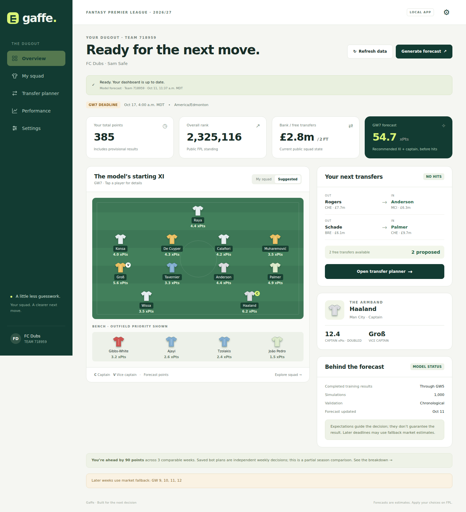

# Gaffe

Gaffe is a Fantasy Premier League squad planner. It forecasts player points over several gameweeks and compares the expected return from making a transfer with the return from keeping your squad.

[App guide](docs/APP.md) · [Mobile view](docs/images/app-mobile.png) · [Model design](docs/design/) · [Run locally](#run-locally)



## Gameweek planning

| Decision | What Gaffe shows |
| --- | --- |
| Spend a transfer or roll it | The projected points gain over holding, accounting for selling prices, available funds and transfer hits. |
| Pick the matchday squad | A starting XI, bench order and captain that fit the formation and club limits. |
| Time a chip | Suggested gameweeks for the available chips across the planning horizon. |
| Review a decision | The points earned by recommendations saved before the deadline, once the gameweek is complete. |

## Forecast and optimization

Gaffe estimates playing time, goals, assists, clean sheets and bonus points using player history, set-piece roles and market-implied team strength. A Monte Carlo simulation combines these outcomes into a distribution of points for each player. A mixed-integer optimizer then selects a squad and plans transfers within the game’s budget and roster constraints.

The Python implementation uses Polars and PostgreSQL for historical inputs, LightGBM for prediction, and Pyomo with CBC for optimization. [Prediction model](docs/design/phase2_5_joint_xpts.md) · [Squad optimizer](docs/design/phase3_deterministic_milp.md) · [Set-piece observations](configs/set_piece_observations.csv)

## Historical benchmark

Each evaluation trained on prior seasons and compared Gaffe with a buy-and-hold squad over 38 gameweeks, with chips disabled.

| Season | Gaffe | Buy and hold | Points gained |
| --- | ---: | ---: | ---: |
| 2024/25 | 2,508 | 2,104 | +404 |
| 2025/26 | 2,331 | 1,994 | +337 |

Some closing odds and player metadata postdate the gameweek deadlines. These figures can therefore overstate what a manager could have achieved live. A full season of pre-deadline forecasts is still needed to measure live performance. [Benchmark methodology and limitations](docs/OPERATIONS_BENCHMARK.md)

## Run locally

Install Python 3.11 or later and uv. From the repository root, install the dependencies and inspect the CLI.

```bash
uv sync --all-extras
uv run gaffe --help
```

Configure PostgreSQL using the app guide, then apply the migrations and launch the dashboard.

```bash
uv run alembic upgrade head
uv run gaffe serve
```

The dashboard opens at `http://127.0.0.1:8080`. Generating forecasts also requires CBC and a populated training database. [App setup](docs/APP.md) · [Forecast runbook](docs/RUNBOOK_live.md)
