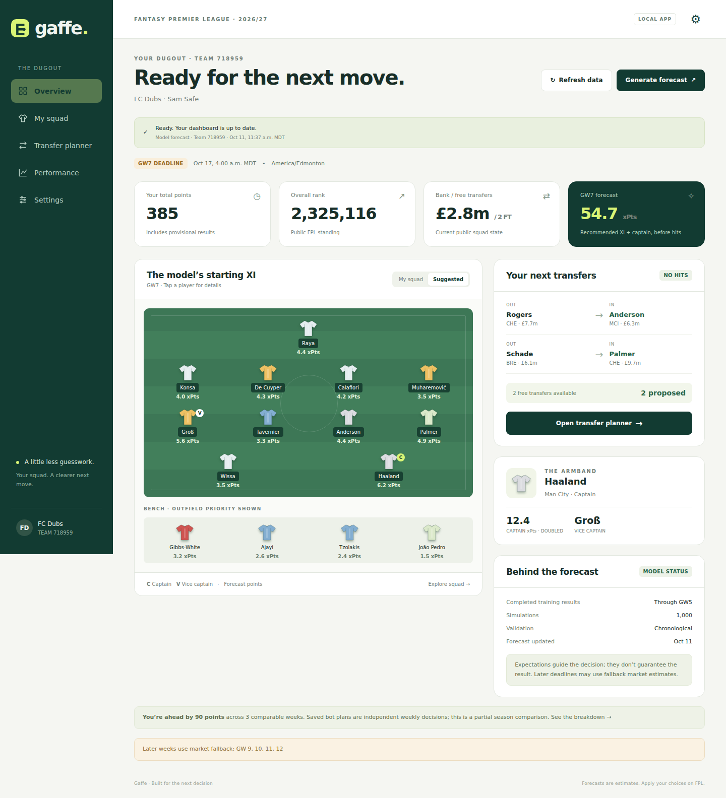
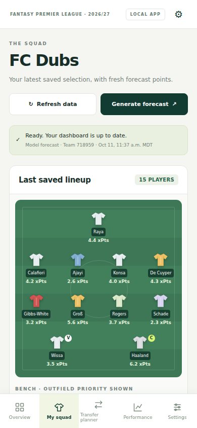

# Gaffe browser app

## Start

Run from the repository root, with the project's existing database and training
data configured:

```bash
uv sync --all-extras
uv run alembic upgrade head
uv run gaffe serve
```

The app opens at `http://127.0.0.1:8080`. `--no-open` suppresses browser launch;
`--port 8081` chooses another port. The server is local and single-process.
It has responsive phone layouts and optional paired HTTPS access.
An existing recommendation and audit snapshot can populate it immediately.
For a fresh clone, use Settings to select an FPL entry, then refresh its data.
Historical model training data and the CBC solver still need the one-time setup
in [the live runbook](RUNBOOK_live.md).

## Daily workflow

1. **Settings:** enter your team ID, forecast horizon and deadline timezone.
2. **Refresh data:** fetch public players, fixtures, entry, history, squad and
   finalized results. Reconstruct bank, free transfers, chips and purchase prices.
   Only finalized single-fixture results enter the per-match training table.
   Double gameweeks remain aggregate actuals until per-fixture sources arrive.
3. **Generate forecast:** refresh bookmaker odds if the saved ones are more
   than six hours old (about 3 credits, plus ~10 for goalscorer odds), train on
   completed matches, simulate the upcoming horizon, and solve the squad, XI,
   captain and transfers. Generate it within a few hours of the deadline: the
   odds and the week's transfer activity are freshest then. More than three
   days out, the minutes model ignores this week's transfers (too few have
   been made) and relies on its history and FPL's injury flags. It can take several
   minutes. Navigation remains usable and a job banner reports progress.
   The overview pairs suggested transfers by position, shows the plan's gain
   over rolling the transfer (and whether it clears the solver's tolerance),
   and lists the chips left this half with their planned gameweeks.
4. **Transfer planner:** begin with the model plan, edit transfers, optionally
   choose a captain, then compare. It enforces 2/5/5/3 squad positions, max three
   per club, exact half-profit sale prices, bank and four-point transfer hits.
5. **Performance:** inspect the independent bot separately from earlier weekly
   recommendations. Start the bot once from your exact current squad and it
   carries its own bank, holdings, transfers and chips. Every forecast you
   generate also drafts the bot's plan, and the last draft saved before a
   deadline becomes its decision, even if the app is closed at the deadline.
   It scores only finalized results. Earlier recommendations
   are a partial comparison that starts from your actual squad each week.
6. Apply the chosen moves on FPL. Refresh near the next deadline.

The instant planner estimates one week's XI plus captain points after hits.
It does not simulate automatic substitutes or chips. The full recommendation
optimizes across its horizon, so the best immediate gain can differ from its
chosen move. Player dialogs show news and the saved horizon forecast.

Public endpoints expose the last deadline's squad. Pending transfers, an active
Free Hit squad and exact purchase prices can require additional state knowledge.
The worker restores the permanent squad after a Free Hit, excludes temporary
Free Hit purchases, retains audited cost basis and flags unknown prices.
Unknown sale prices prevent a budget-safe recommendation. Never interpret an
unrefreshed public snapshot as authenticated account synchronization.

Bookmaker refresh is optional in Settings and consumes the configured API's
request allowance. The dashboard reports later weeks with market fallback.

## Scheduled updates and persistent service

Enable **Run scheduled updates** in Settings. The scheduler checks once a minute
and uses the same single-job queue as manual actions. It refreshes every six
hours, or hourly while results are provisional or a frozen bot week awaits
settlement. It runs a complete refresh, your forecast and the independent bot
six hours before deadlines, then again 90 minutes before deadlines. The final
cycle freezes the bot; a lightweight fallback freezes the latest saved draft
15 minutes before the deadline. Failed slots retry after 15 minutes.

If the computer is asleep through the final run and the fallback, the catch-up
after waking freezes the last draft saved before the deadline, marked
"frozen late". Drafts are hashed when saved, and a draft that fails that check,
or was not completed before the deadline, is not used. Only a deadline with no
usable draft is missed: it stays unscored and carries the bot's squad and free
transfers forward.

**Quiet hours** (Settings → "Computer usually asleep") cover overnight
deadlines. When the 90-minute run would fall inside them, the first forecast
cycle starts 45 minutes before quiet hours begin, the evening before, instead
of six hours ahead. Leave both times blank to keep the plain schedule.

The independent bot uses recorded forecast prices. Its initial state matches
the public squad, which may exclude transfers made since the previous deadline.
The hash chain detects edits to frozen decisions; it is local integrity evidence,
not third-party certification of the computer's clock or files.

On Linux with a running user systemd session:

```bash
uv run gaffe install-service
systemctl --user status gaffe.service
systemctl --user restart gaffe.service
systemctl --user stop gaffe.service
```

The unit uses this checkout's virtual environment and starts at port 8080.
It restarts after process failure and starts with the user's session. It does
not keep the computer awake or guarantee operation after logout. Reinstall the
unit if you move the checkout. Do not run a second server over the same store.

## Phone alerts

Settings → "Phone alerts" takes a private [ntfy](https://ntfy.sh) topic. Press
**Create** for a random one, save, subscribe to it in the free ntfy app, then
press **Test**. Alerts go out when a scheduled forecast cycle finishes (repeated
only when the advice changes), when it fails, and when the bot misses a
deadline. They contain player names, captain, expected points, the plan's gain
over rolling the transfer and the deadline: no team ID, bank or credentials.
Anyone who knows the topic can read it, so treat the topic as a password.
Blank topic, no traffic.

## Pair a phone

On the desktop, open **Settings → Phone access**. Enable access and install the
optional official Cloudflare tunnel helper for a trusted HTTPS address across
networks. The app verifies the official release binary's SHA-256 digest before
installing it. Create a pairing link, then scan the QR code or open the link on
the phone. The link expires in five minutes and can be used once. It grants
access, so keep it private. Paired devices receive a secure, HTTP-only cookie
valid for 30 days; only its hash is saved. Revoke devices or disable access from
the desktop. The phone cannot manage pairing or network settings.

The localhost app remains at port 8080. A separate HTTPS gateway listens on
8443 for local access with a private certificate; a loopback HTTP gateway on
8444 sits behind the encrypted tunnel. Unpaired clients cannot read team data
or trigger jobs. The public tunnel URL changes after restart, requiring a fresh
pairing on the new hostname. The desktop service and internet connection must
remain running. A permanent domain requires separate hosting configuration.

Schedule slots, the bot ledger, certificates, device hashes and the verified
helper are stored in ignored `data/web/`; none are committed. The decision ledger
lives at `data/web/season_N/team_ID/bot/ledger.json`, with full forecast artifacts
under its `forecasts/` folder. See the [corrected benchmark](OPERATIONS_BENCHMARK.md)
for evidence and historical data timing limits.

## Data and local boundary

- `data/web/preferences.json`: team, horizon and timezone, without credentials.
- `data/web/season_N/team_ID/snapshots/`: complete public snapshots. An atomic
  pointer publishes a new snapshot only after its public requests finish.
- `data/web/jobs/`: durable safe progress records; unfinished jobs are marked
  failed after an app restart.
- `data/live/recommendations/season_N/team_ID/gw_G/`: new per-team forecasts.
  Existing primary recommendations remain intact. Timestamped archives preserve
  each new run and prevent failed solves overwriting a usable recommendation.
- Legacy artifacts are only used when team and season match.

API keys, cookies, access tokens, connection strings and raw worker logs are
never returned to the browser. Mutations require an ephemeral same-origin
token, and the server accepts local hosts. Phone access adds a paired single-owner gateway; this is not a multi-user
service. Job requests select fixed worker operations,
with validated numeric inputs; the API does not accept shell commands or paths.

If a job fails, the dashboard retains existing snapshots/forecasts and reports
a safe error. Check database migrations, historical data and the solver using
the runbook. A public snapshot may be saved even if database ingestion fails.
Only one refresh or forecast job runs at a time; wait before changing settings.

## Architecture and verification

FastAPI serves the API and bundled static HTML, CSS and JavaScript; Uvicorn runs
the local process. No frontend build system, CDN or hosting account is required.
The worker runs in a separate Python process to keep model work off HTTP threads.
FastAPI's documented [static file serving](https://fastapi.tiangolo.com/tutorial/static-files/)
provides the bundled assets. The API tests exercise planning constraints,
partial comparisons, credentials, origin checks, team isolation, refresh-state
reconstruction and overlapping/restarted jobs.

```bash
uv run pytest tests/unit/test_web_app.py -q
uv run ruff check src tests
```




